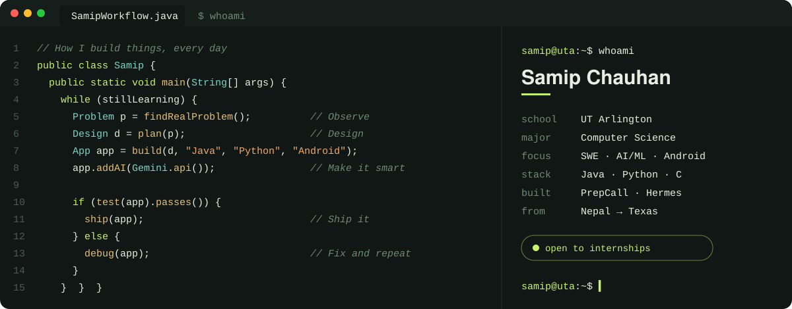

<h3 align="center">
  <a href="https://samipchauhan99.github.io">Portfolio</a> &nbsp;|&nbsp;
  <a href="https://linkedin.com/in/samip-chauhan">LinkedIn</a> &nbsp;|&nbsp;
  <a href="mailto:samipchauhan28@gmail.com">Email</a> &nbsp;|&nbsp;
  <a href="https://samipchauhan99.github.io/Samip_Chauhan_Resume.pdf">Resume</a>
</h3>

  

---

## Skills

### Programming Languages

  

### Frameworks & Databases

  

### Tools

  

---

## Featured Projects

| Project | What it does | Built with |
|---|---|---|
| **PrepCall** | AI video mock interviewer: live behavioral and coding interviews with graded feedback | Python · FastAPI · React · PostgreSQL · Gemini API |
| **[Hermes](https://hermesguard.us)** | AI scam guard for older adults, built at HackUTA 2026 | Python · FastAPI · Gemini API · MongoDB |
| **[Co-Live](https://github.com/thapaliya-07/Co-Live)** | Android app for shared households: bills, chores, groceries | Java · Android · Firebase |
| **Sorting Benchmark Suite** | QuickSort pivot strategies vs. Merge and Insertion Sort on 1M+ elements | C · Linux |

---

